# Phase 9 · Step 1 — Full Visual & UX Audit

**Transcorp Subscription Planner — Admin + Merchant-Operator areas**
Walked live on **planner-olive-sigma.vercel.app**, 22 June 2026 · read-only session (no data touched) · 1440×900 desktop + 390×844 mobile.

> **What this is:** the scoping catalogue you review *before* any redesign is authorized. Every surface in both areas, screenshotted, with each visual/UX defect catalogued through a design-system lens — plus the synthesis of the shared components that don't exist and should. **No code was changed. No PR was opened.** This document is the artifact; Step 2 (the design-system proposal) only begins once you've read it and said go.
>
> **Coverage:** 37 desktop + 5 mobile surfaces (22 admin, 15 merchant). Nothing was unreachable.

---

## 1. The one-sentence diagnosis

**The drift you saw is not a pile of unrelated bugs — it is the predictable result of there being no shared component layer.** Every page builds its own button, its own status pill, its own table, its own field row, its own page width, its own empty state, its own way of writing a label. When each screen re-invents the same six or seven primitives, they inevitably disagree — and they do, on *every* axis: button size, button colour, status style, table density, ID-vs-name, casing, spacing, width, empty states, terminology. #547's "aesthetic pass" tightened a few surfaces by hand; it could never hold, because there is nothing central to hold the line.

Fixing individual screens will not fix this. **The fix is to build the missing shared layer and route every screen through it.** This audit shows you exactly where the seams are.

---

## 2. Your eight flags — confirmed and expanded

Every issue you flagged reproduced. Several were worse or broader than first described.

| # | Your flag | Verdict | What I actually found | Evidence |
|---|-----------|---------|------------------------|----------|
| 1 | Admin Overview still counts test tenants | **Confirmed — bigger** | Leaks in **three** places: the **"736" Active Merchants** stat (genuine = 8), the **entire top-10 leaderboard** ("Service B Test Tenant" ×10), and a **per-merchant breakdown of hundreds of tenants**. #546's filter never reached the dashboard. | `admin-06` |
| 2 | Reset/Disable buttons different sizes (Users) | **Confirmed** | "RESET PASSWORD" wraps to 2 lines → tall; "DISABLE" stays 1 line → short. Buttons have no fixed sizing. | `admin-13` |
| 3 | "Created" date wraps (Users) | **Confirmed** | "2026-05-" / "17" — column too narrow; date wraps. Plus emails, names, and headers wrap on the same table. | `admin-13` |
| 4 | "Refresh now" different sizes (Asset Tracking + Inventory) | **Confirmed** | Wraps to 2 lines beside long merchant names, 1 line beside short ones; the button shares the name cell, so name length deforms it. | `admin-17`, `admin-19` |
| 5 | Inventory alignment off, names should be 1 line, "1 date"/"2 date" misaligned | **Confirmed** | Names wrap to 2 lines; "(1 date)" / "(N date)" labels sit at inconsistent positions; also a "(1 consignees)" grammar bug. | `admin-19`, `merchant-12` |
| 6 | Subscriptions shows raw consignee ID hash, not name | **Confirmed — and it's a clean bug** | Admin list shows `c9fdc03c`… The **merchant** list shows the **name** as a link. The correct rendering already exists; admin just renders the wrong field. | `admin-11`, `merchant-08` |
| 7 | Table headers wrap to two lines | **Confirmed — pervasive** | "ASSETS"/"ALLOCATED", "SUPP."/"QTY", "EN"/"ROUTE", "RESOLVED"/"AT", "FIRST"/"FAILED", "MERCHANT / DELIVERY DATE". Across every report + the resolved-pushes table. | `admin-17/19`, `merchant-12/14` |
| 8 | Edit-user has no EMAIL field | **Confirmed — product gap** | Email is read-only on Edit; only name + role are editable. It *is* editable at **create**, so the omission is an oversight, not a constraint. | `admin-15`, `admin-16` |

---

## 3. The headline finding: test data is everywhere a real person looks

This deserves its own callout because it's the single most damaging thing in the product right now — it makes a finished-looking app look broken/unfinished the moment anyone reads the numbers.

**Admin Overview (`/admin/calendar`, labelled "Overview"):**

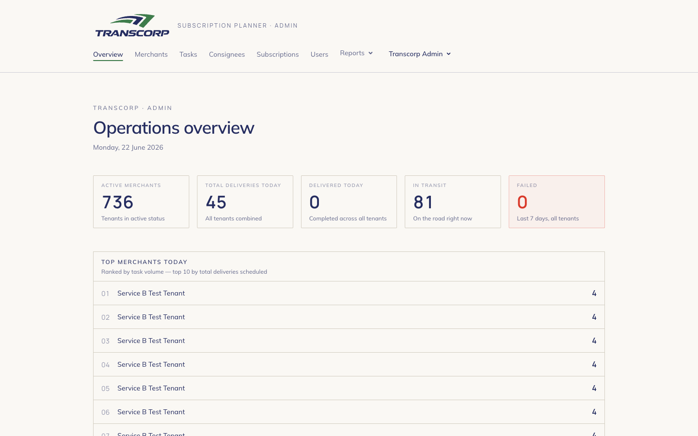

- **"736" Active Merchants** — genuine is **8**. The other ~728 are automated-test tenants.
- **Top-10 leaderboard is entirely "Service B Test Tenant".**
- The **per-merchant breakdown** renders *hundreds* of tenants (the page's accessibility tree is 4,581 nodes) — also a real **performance** problem (no pagination/virtualisation).

And it isn't only the admin dashboard. **Real merchant operators see test junk in their own tenant too:**
- Merchant Consignees: **215 total**, including a consignee literally named **"Test 1"** and dozens sharing one phone (`+971501122334`) and one address. (`merchant-04`)
- Merchant Subscriptions: **225 total**, one named **"UAT R4/R5 address-override probe (Day-53)"**. (`merchant-08`, `merchant-09`)
- Admin Regions: **74 regions**, nearly all identically named "ACD OAuth Region" with synthetic client IDs. (`admin-20`)

**The genuine-merchant filter (#546) was applied to exactly one surface (the Merchants list) and nowhere else.** Every count, leaderboard, and breakdown needs the same fence — and the seed/test rows need cleaning out of production.

---

## 4. The cross-cutting design-system gaps (the heart of this audit)

Here are the shared primitives that **don't exist** and must. Each is the root cause of a whole family of the defects above. This is the spec surface for Step 2.

### Gap A — There is no `Button`
One label renders at different sizes and different colours depending on the page.
- **Size:** "RESET PASSWORD" / "REFRESH NOW" / "+ NEW MERCHANT" / "+ NEW REGION" all wrap to 2 lines in some contexts and 1 in others. No min-width, no fixed height. (`admin-13/17/19/05/20`)
- **Colour:** primary is **green** on Merchant/Region forms but **navy** on User forms — and **outline** on the merchant detail page for the *same* "Update merchant" action that is **green-filled** on the edit page. (`admin-02` vs `admin-03`; `admin-15` vs `admin-22`)
- **Style zoo on one page:** outline button + text link + icon button + green-filled + navy-filled all co-exist. (`admin-02`)
→ **Need:** one `Button` with fixed `size` tokens and `variant` (primary / secondary / ghost / danger), one canonical primary colour, never text-wrapping.

### Gap B — There is no `StatusBadge`
The same status concept renders **four** different ways:
- **Filled pill** (Merchants "ACTIVE", Consignees CRM), **outline pill with strikethrough** (Consignees "CHURNED"), **coloured dot + text** (Subscriptions "ACTIVE/PAUSED/ENDED"), **bare grey text with no badge at all** (task "SKIPPED"/"CANCELLED"). (`admin-01/09/11/07`)
- A single page shows a status **both** as a pill **and** as plain text ("CREATED" twice on the task detail). (`admin-08`)
→ **Need:** one `StatusBadge` with a per-status variant map, used everywhere a status appears.

### Gap C — There is no `Table` / density + responsive rule
- **Header wrapping** everywhere (Gap #7 above).
- **Desktop overflow:** the merchant Tasks table is wider than 1440px — the TEL column is clipped off-screen *on desktop*. (`merchant-02`)
- **No responsive strategy:** every table simply overflows the viewport on mobile; no card/stacked layout. (`admin-13-mobile`, `merchant-04-mobile`)
- **No truncation policy:** some cells truncate with "…" (task address), most don't, so names/emails/UUIDs wrap unpredictably.
- **Raw UUIDs in cells** wrapping to 3 lines (resolved pushes TASK column). (`merchant-14`)
→ **Need:** one `Table` with header `nowrap`, per-column min-width + truncation, a defined row density, and a documented mobile behaviour (stacked cards).

### Gap D — There is no `DetailView` / `FieldRow` (admin and merchant don't even agree)
- **Admin detail pages:** single-column FieldRows, **UPPERCASE letter-spaced** labels, no tabs, locked to a narrow ~560px left column. (`admin-02/08/10/12`)
- **Merchant detail pages:** **tabbed** (Overview/Subscription/Calendar/History), a **2-column grid**, **sentence-case** labels, day-chips. (`merchant-05/09`)
- These are **two unrelated detail systems**, and even within one entity the labels disagree (consignee *detail* uses sentence case, consignee *edit* uses uppercase). (`merchant-05` vs `merchant-06`)
- A recurring component bug: the **"AUTH METHOD" value is indented further right than every other value**, on both the merchant detail and the region detail — the same stray-padding bug wherever that row is used. (`admin-02`, `admin-21`)
→ **Need:** one `DetailView` + `FieldRow`, one label-casing rule, one empty-value rule (see Gap H).

### Gap E — There is no `PageShell` (page width is random)
- List pages: full-width. Detail pages: **narrow ~560px left column** (merchant/task/consignee/subscription) **or** **wide centred ~900px** (user/region/credentials). Three different widths with no logic. The narrow detail pages leave the entire right half of the screen empty. (`admin-02` vs `admin-14` vs `admin-04`)
→ **Need:** one `PageShell` with a defined max-width + content grid; detail pages should use the horizontal space (two columns), not strand it.

### Gap F — There is no `StatCard`
Two incompatible stat-card designs: a **5-card grid** (Overview, Calendar) and a **single wide number-left/label-right bar** (Merchants, Tasks, Consignees, Subscriptions-has-none). On merchant Tasks the wide card even **swallows a "Per page" dropdown** inside it. (`admin-06` vs `admin-01`; `merchant-02`)
→ **Need:** one `StatCard` + a rule for when a page gets stat cards (some lists have a count card, some don't).

### Gap G — There is no `FormControl` (inputs are a mix of custom + raw OS)
- Native browser `<select>` and native date/time pickers sit beside custom-styled text inputs on the same form. (`admin-07/15/16`, `merchant-10/11`)
- Good one-off patterns exist but are used nowhere else: **radio-cards** (region/new), **day-chip toggles** (subscription edit/new), **cadence presets + live preview** (subscription new), **segmented controls** (calendar, subscription new). (`admin-22`, `merchant-10/11/03`)
- Placeholders look like real values (concrete grey example text reads as filled data). (`admin-03`)
→ **Need:** one styled `Select` / `DateField` / `TimeField` + promotion of the good one-offs (chips, segmented, preview) into the shared kit.

### Gap H — There is no `EmptyState`
Four different empty treatments: a **bordered card with guidance** (asset log), **plain centred text** (failed pushes), a bare **"—" em-dash** in detail fields, and **nothing** in empty list bodies. (`admin-18`, `merchant-13`, `admin-02`)
→ **Need:** one `EmptyState`, used for every zero/empty surface, including detail fields.

### Gap I — No type / casing / formatting tokens
- **Casing is unsystematic:** title-case H1s, UPPERCASE letter-spaced eyebrows + labels + column headers, sentence-case card titles — often all on one page. (`admin-04`)
- **Monospace is applied ad hoc** — slugs, IDs, dates, windows, AWBs, codes — with no rule for when. (`admin-08`)
- **Time formatting disagrees with itself:** "09:00 – 21:00" on a list but "09:00:00 – 21:00:00" (full seconds) on that list's own detail. (`admin-11` vs `admin-12`)
→ **Need:** a small type scale + casing rule + canonical formatters for date/time/phone/ID.

### Gap J — Data is shown as the database stores it, not as a person reads it
This is the writing/IA layer of the same problem:
- **Raw IDs** instead of names (admin subscriptions hash), **raw UUIDs** in cells (resolved pushes), **raw role slugs** ("tenant-admin" on the users list, humanised "Tenant Admin" on the detail). (`admin-11/14/13`)
- **Phones unformatted** (E.164 `+971503333333` everywhere). (`admin-09/10`)
- **Engineer vocabulary aimed at operators:** "OPERATIONS · DLQ", "dead-letter queue", "5 requests per second", "timing-safe comparison", and even **"deferred to a future commit"** sitting in the live UI. (`merchant-13/14/15`)
- **Terminology drift for one entity:** "consignee" vs "subscriber" vs "merchant subscriber" on the merchant home. (`merchant-01`)
→ **Need:** a humanise layer (names not IDs, labels not slugs, formatted phones), and a single product vocabulary that names things by what the user controls.

---

## 5. Recommended visual direction

This is **direction, not the design** (that's Step 2). Framed through a premium, design-system-first lens.

**Position the product as a dense, premium operations console — not an airy brochure.** The current look (cream field, navy headings, green accent, lots of whitespace, low information density) is calm but under-built and reads as unfinished. A logistics control surface earns trust through **density, alignment, and consistency**, not whitespace. Keep the established Transcorp brand tokens (navy / green / cream from brief v1.4) — the problem isn't the palette, it's the absence of a system. The direction:

1. **Build the shared kit first (Gaps A–J), then refactor screens onto it.** One `Button`, `StatusBadge`, `Table`, `DetailView`/`FieldRow`, `PageShell`, `StatCard`, `FormControl`, `EmptyState` + type/casing/formatter tokens. This is the whole game.
2. **Pick one casing system and one primary colour, and enforce them.** Recommendation: sentence-case for everything human-facing, reserve UPPERCASE for small eyebrows only; one primary button colour (the brand green) with navy as secondary.
3. **Raise table density and make tables responsive.** Tighter rows, `nowrap` headers, per-column truncation with tooltip, and a documented mobile card layout. Tables are the core of this product — they should be the most polished thing in it.
4. **Use the horizontal space.** Detail pages should be two-column and fill the viewport, not strand the right half.
5. **Promote the good one-offs into the kit.** Day-chips, segmented controls, cadence presets, and the live "will create N deliveries" preview are genuinely good — they should be standard, not exceptions.
6. **Add a humanise layer + one vocabulary.** Names not IDs, formatted phones, human role labels, operator language (not "DLQ"/"cron"), one noun per entity.
7. **Fence and clean the test data** so every number a person sees is real.

The signature move for this product isn't decorative — it's **earned consistency**: the same button, badge, table, and field row everywhere, at high density, with real data. That alone will move it from "looks unfinished" to "looks premium."

---

## 6. Surface-by-surface catalogue (the evidence)

Each surface: screenshot + its defects. Admin first, then Merchant. Repeated cross-cutting issues are noted briefly and rolled up in §4.

### ADMIN

#### A1 · Merchants list — `/admin/merchants`
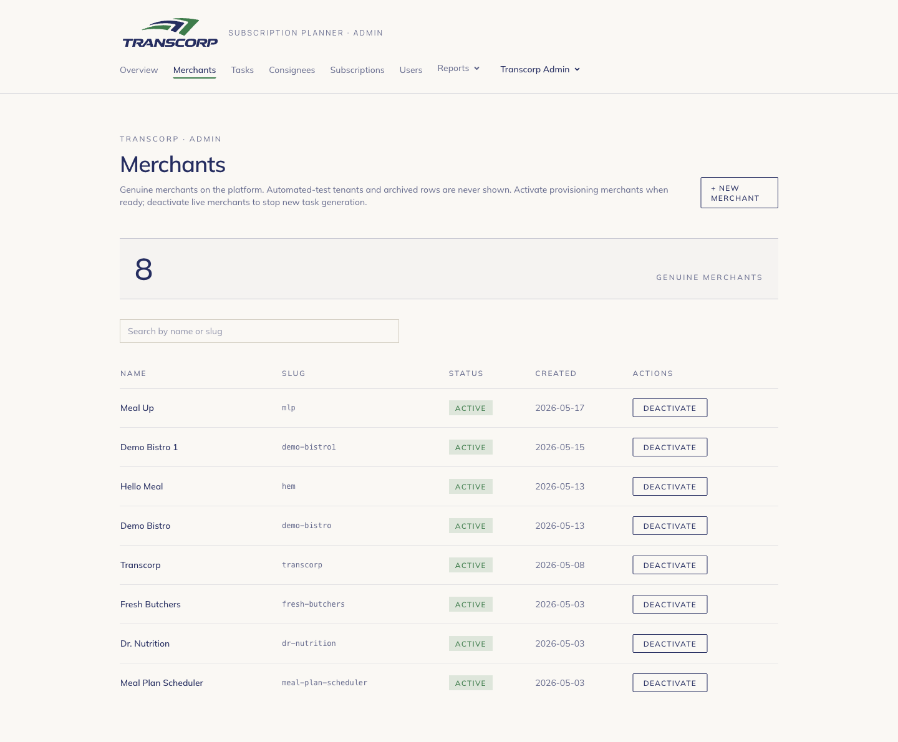
- "+ NEW MERCHANT" button **wraps to 2 lines**. (Gap A)
- Stat card splits number hard-left / label hard-right with dead space; unbalanced. (Gap F)
- Casing zoo: title-case H1, uppercase column headers, uppercase eyebrow. (Gap I)
- Slugs in monospace, names in sans. (Gap I)
- "ACTIVE" pale low-contrast pill; "DEACTIVATE" outline button overlaps the whole-row link target. (Gap B/A)
- ✅ The genuine-merchant filter works *here* ("8 Genuine merchants") — the only place it does.

#### A2 · Merchant detail — `/admin/merchants/[id]`
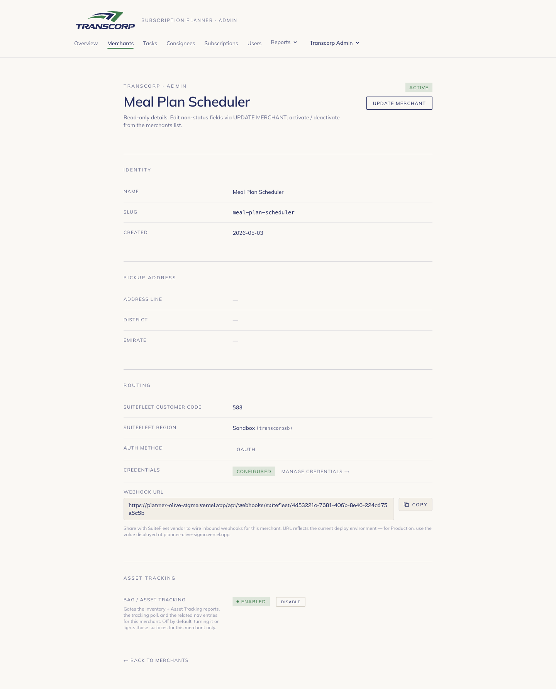
- Content locked to ~560px; right half of the screen empty. (Gap E)
- "UPDATE MERCHANT" is an **outline** button here (it's green-filled on the edit page). (Gap A)
- **"AUTH METHOD" value indented** further right than all other values. (Gap D bug)
- Three stacked "—" rows for empty pickup address. (Gap H)
- Pill zoo: ACTIVE / CONFIGURED / ENABLED + DISABLE button. (Gap B)
- Webhook URL wraps inside its box.

#### A3 · Merchant edit — `/admin/merchants/[id]/edit`
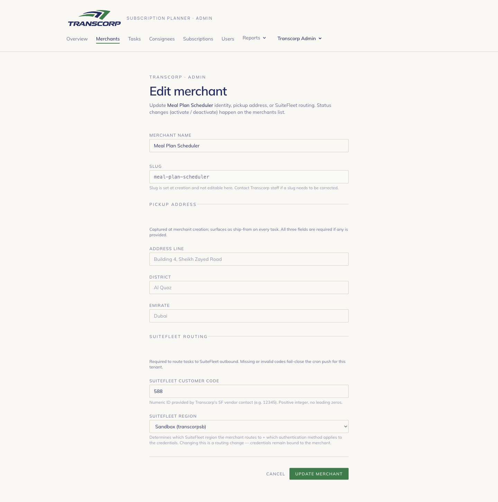
- "UPDATE MERCHANT" is **green-filled** here vs outline on detail — same action, two styles. (Gap A)
- Pickup-address placeholders look like real values. (Gap G)
- Native `<select>` for region among custom inputs. (Gap G)

#### A4 · Merchant credentials — `/admin/merchants/[id]/credentials`
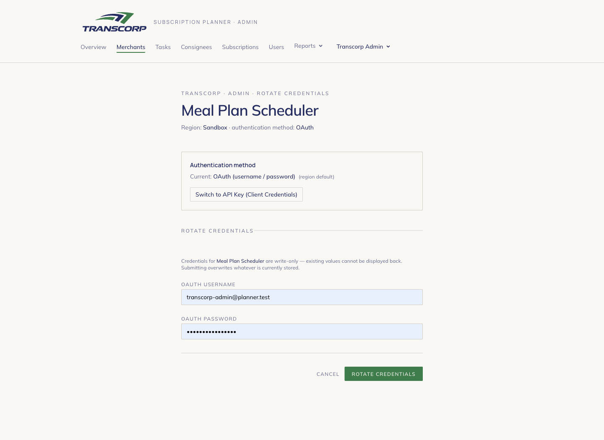
- **Page is centred ~900px** vs the narrow ~560px detail/edit pages. (Gap E)
- Card title "Authentication method" sentence-case while section header is uppercase. (Gap I)
- Mixed containers (one bordered card, one bare section).

#### A5 · New merchant — `/admin/merchants/new`
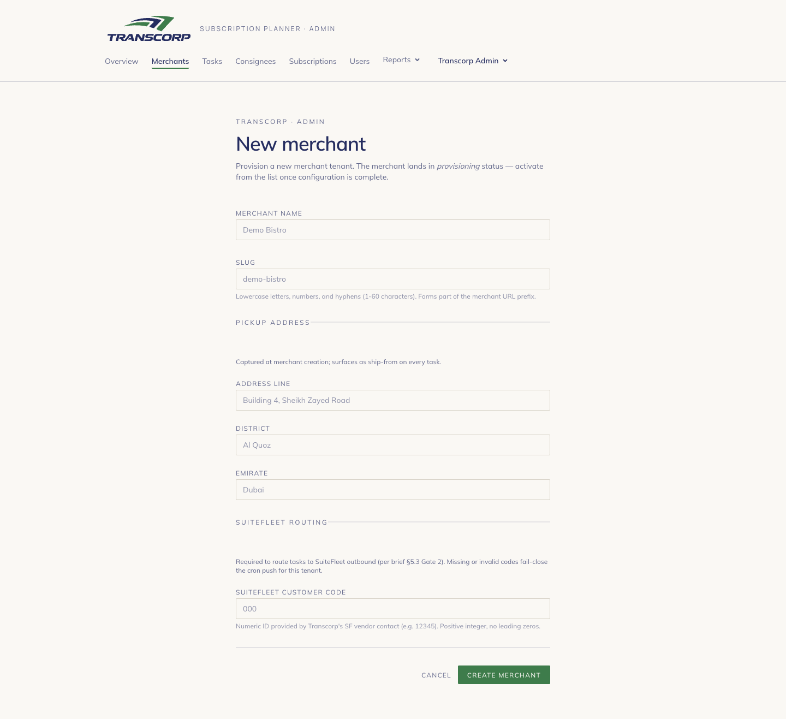
- **Field set differs from edit** (no SuiteFleet Region select here). (Gap G)
- Concrete-looking placeholders; narrow left column.

#### A6 · Overview / "Operations overview" — `/admin/calendar`

- **The headline test-tenant leak** (§3): 736 stat, all-test top-10, hundreds-of-rows breakdown.
- 5-card stat grid here vs single-card style elsewhere. (Gap F)
- Route is named `calendar`, nav says "Overview", content is a dashboard — three names for one thing. (Gap J)
- *(Full-height capture: `screenshots/admin-06-overview.png` — shows the unbounded scale.)*

#### A7 · Tasks list — `/admin/tasks`
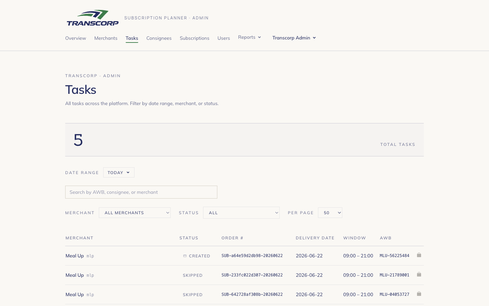
- "TOTAL TASKS 5" wide card (≠ Overview's grid). (Gap F)
- Mixed dropdowns: custom "TODAY" button + native selects. (Gap G)
- "CREATED" has an icon-badge, "SKIPPED" is bare text. (Gap B)

#### A8 · Task detail — `/admin/tasks/[id]`
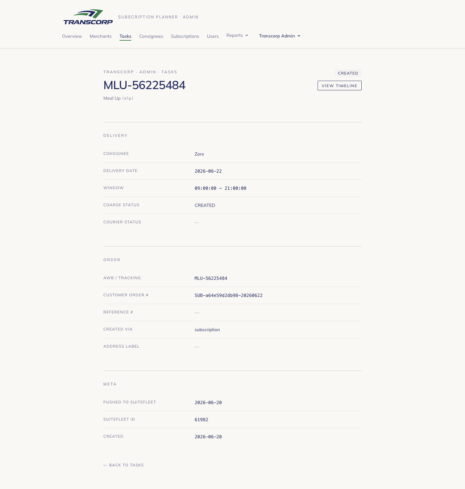
- Status shown **twice, two ways** (pill + plain text). (Gap B)
- Monospace overload; window shows full **seconds** "09:00:00 – 21:00:00". (Gap I)
- Three "—" empty rows. (Gap H) · ✅ consignee shows the real name "Zoro".

#### A9 · Consignees list — `/admin/consignees`
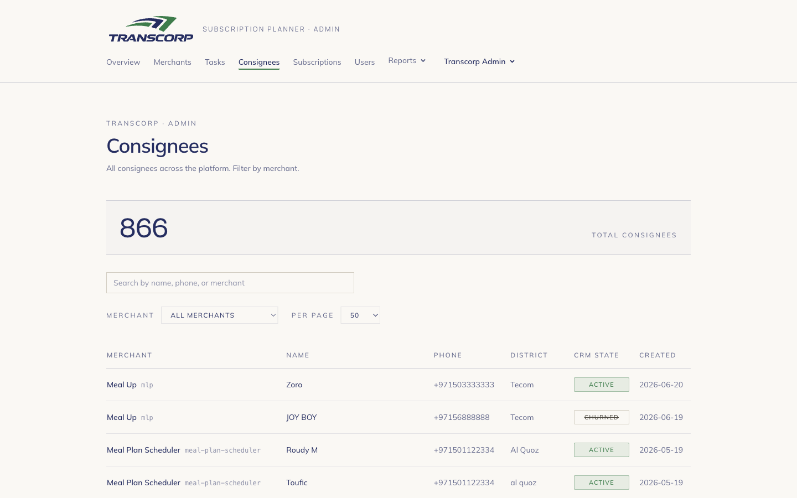
- **866 total** — includes test-tenant consignees (no genuine filter). (§3)
- Phones raw E.164. (Gap J)
- CRM badges diverge: ACTIVE green fill vs CHURNED **outline + strikethrough**. (Gap B)

#### A10 · Consignee detail — `/admin/consignees/[id]`
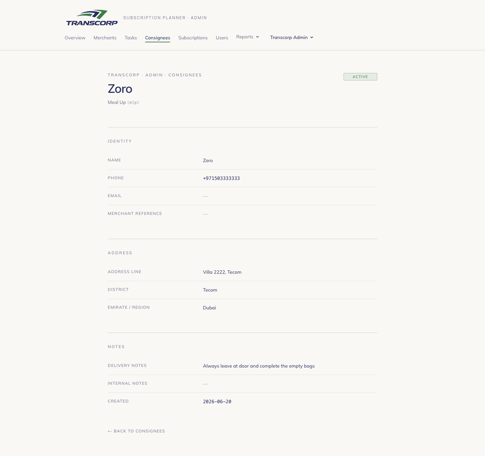
- Narrow column; raw phone; three "—" empty rows; mono date. (Gaps E/H/J/I)

#### A11 · Subscriptions list — `/admin/subscriptions`
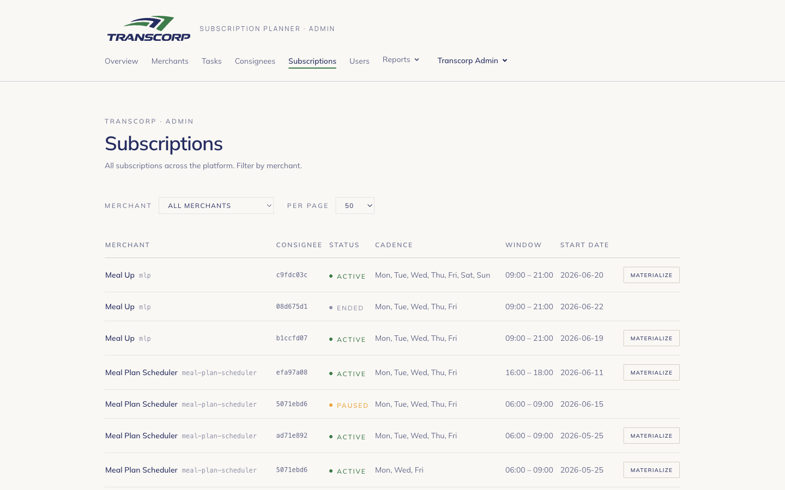
- **Consignee column = raw UUID hash** (`c9fdc03c`…) instead of the name. (Flag #6 — the merchant list proves the name is available; see M8.)
- Status = dot+text (a *third* status style). (Gap B)
- No count stat-card while the other lists have one. (Gap F)
- Cadence shown as full literal "Mon, Tue, Wed, Thu, Fri, Sat, Sun". (Gap I)

#### A12 · Subscription detail — `/admin/subscriptions/[id]`
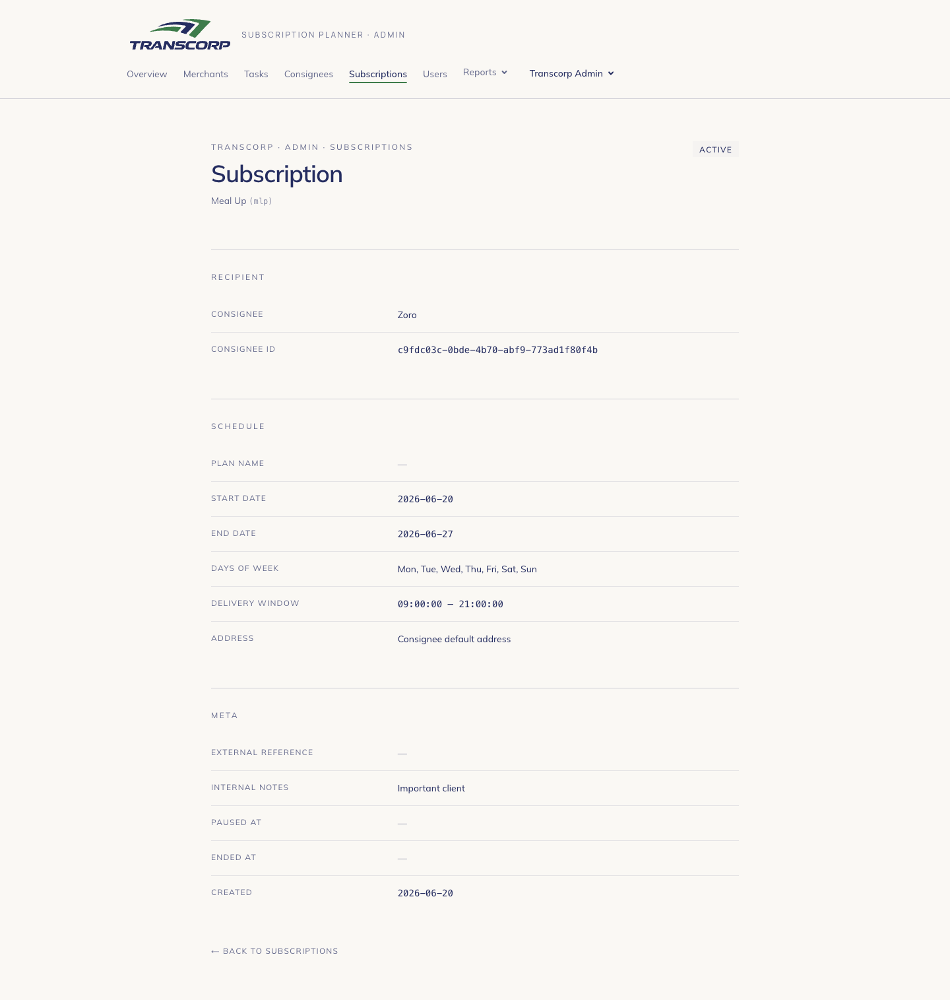
- Resolves **CONSIGNEE = "Zoro"** *and* a full CONSIGNEE ID → proves the list hash is just the wrong field. (Flag #6)
- Window shows **seconds** here though the list omitted them. (Gap I)
- Generic H1 "Subscription"; four "—" empty rows. (Gap H)

#### A13 · Users list — `/admin/users` *(your flags #2, #3)*
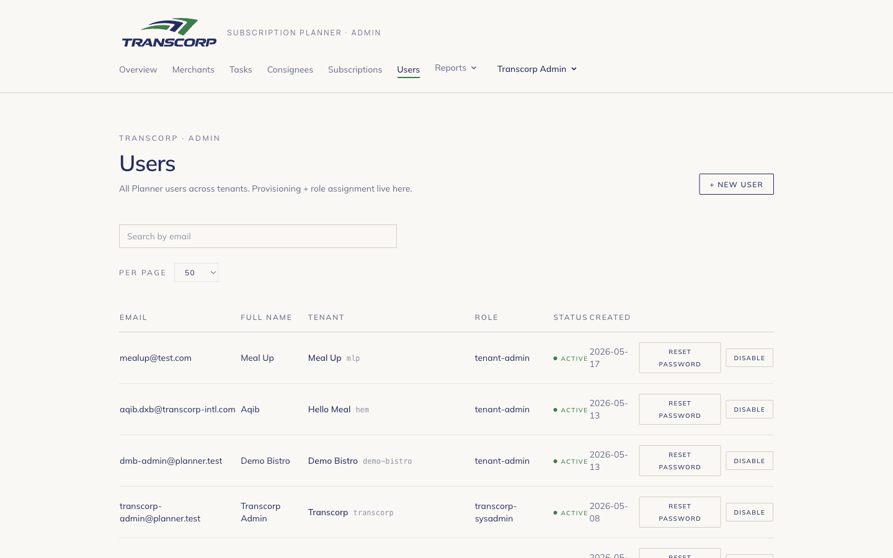
- **RESET PASSWORD wraps (tall) / DISABLE single-line (short)** — mismatched buttons. (Flag #2 / Gap A)
- **"Created" date wraps**; STATUS/CREATED headers collide; emails + full names wrap. (Flag #3 / Gap C)
- Role shown as **raw slug** "tenant-admin". (Gap J)

#### A14 · User detail — `/admin/users/[id]`
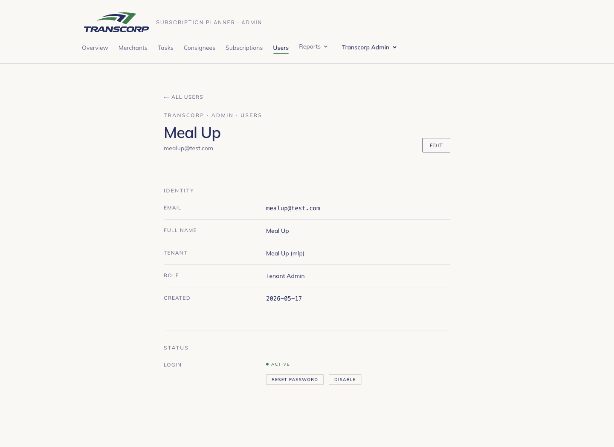
- **Wide ~900px** (≠ narrow details). (Gap E)
- Role **humanised** here ("Tenant Admin") but raw on the list. (Gap J)
- Back-link at **top** here vs **bottom** elsewhere.
- RESET/DISABLE are equal-size here (room available) — proves the list mismatch is layout, not the button.

#### A15 · User edit — `/admin/users/[id]/edit` *(your flag #8)*
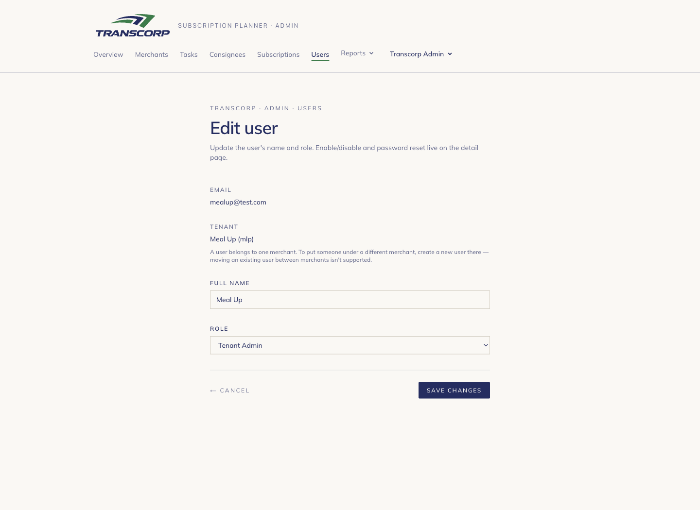
- **No editable EMAIL field** — email is read-only display text. (Flag #8)
- Primary is **navy** "SAVE CHANGES" (≠ green elsewhere). (Gap A)
- Read-only vs editable fields not visually distinguished. (Gap G)

#### A16 · New user — `/admin/users/new`
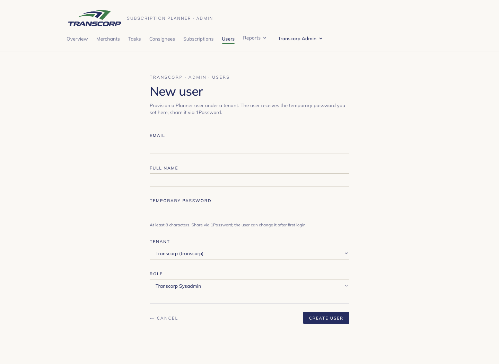
- Email **is** editable at create — confirms #8 is an omission, not a constraint.
- Navy primary; native selects.

#### A17 · Asset Tracking — `/admin/asset-tracking` *(your flags #4, #7)*
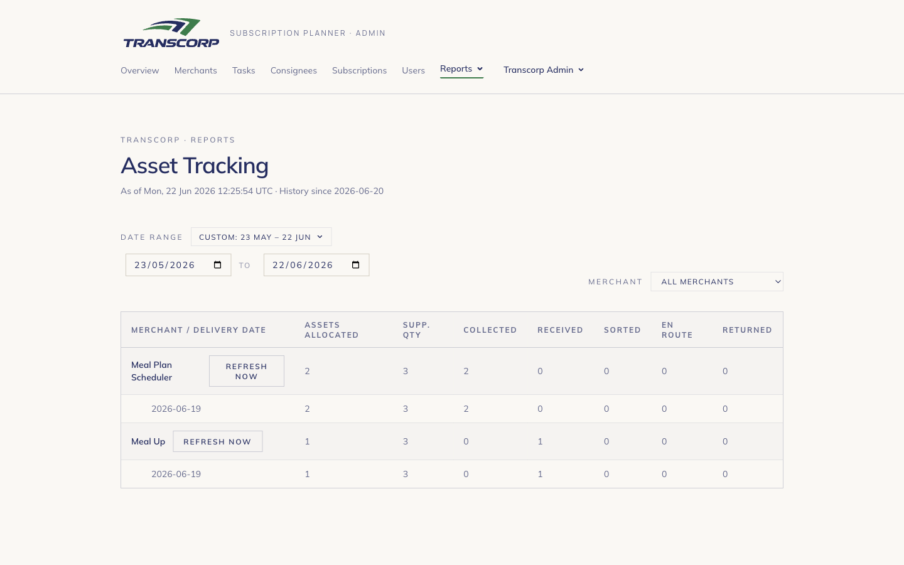
- **"REFRESH NOW" wraps beside long names, not short ones** — button shares the name cell. (Flag #4 / Gap A)
- **Headers wrap** ("ASSETS"/"ALLOCATED" etc.). (Flag #7 / Gap C)
- Filter row unbalanced (date inputs left, merchant select stranded far-right).

#### A18 · Asset Log — `/admin/asset-tracking/log`
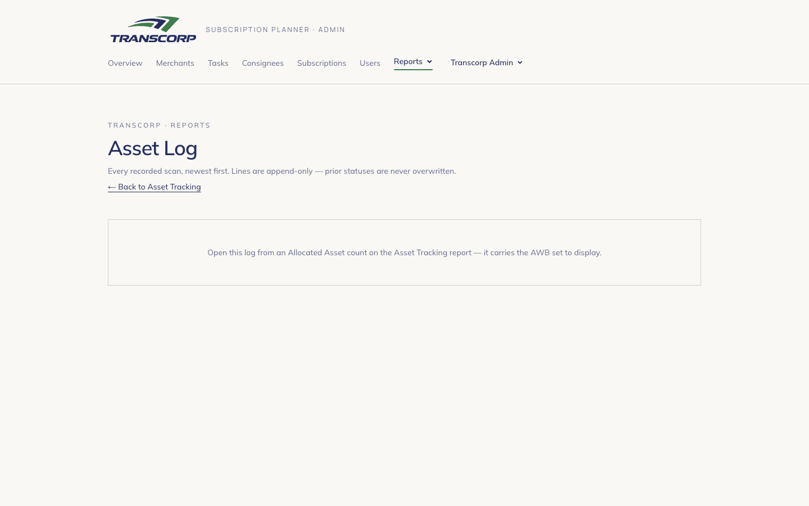
- Empty state is a **bordered card with guidance** — good, but a *different* empty style than everywhere else. (Gap H)
- Back-link underlined sentence-case vs uppercase elsewhere.

#### A19 · Inventory — `/admin/inventory` *(your flag #5)*
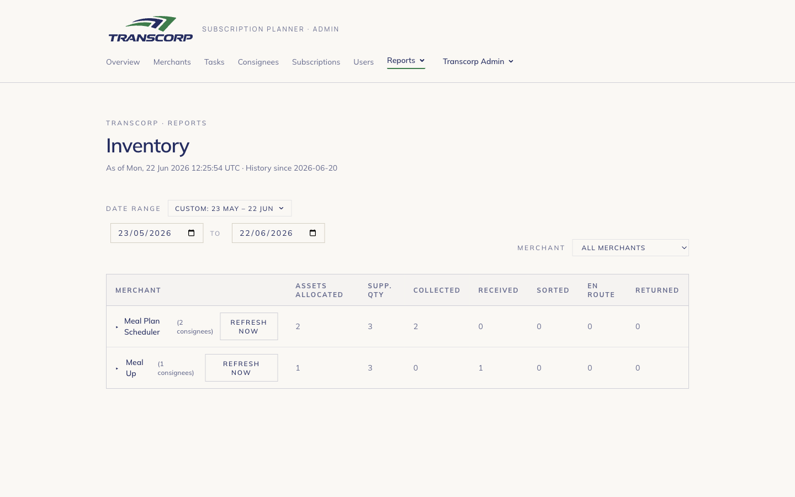
- **Names wrap to 2 lines** (you wanted one); merchant cell crams caret + name + "(N consignees)" + REFRESH NOW button, **misaligned row-to-row**. (Flag #5)
- **"(1 consignees)" grammar bug.** Headers wrap.
- Near-duplicate of Asset Tracking (first of three near-identical report tables).

#### A20 · Regions — `/admin/regions`
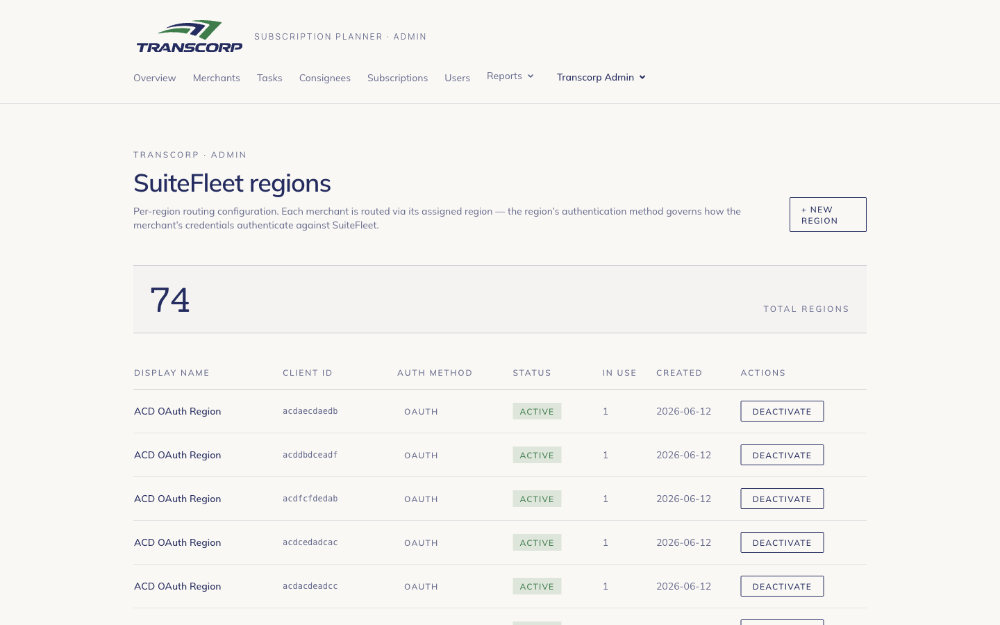
- **74 regions, nearly all "ACD OAuth Region"** (synthetic). (§3)
- "+ NEW REGION" **wraps to 2 lines** (like "+ NEW MERCHANT"; unlike "+ NEW USER"). (Gap A)
- Status = green pill here (vs dot elsewhere). (Gap B)

#### A21 · Region detail — `/admin/regions/[id]`
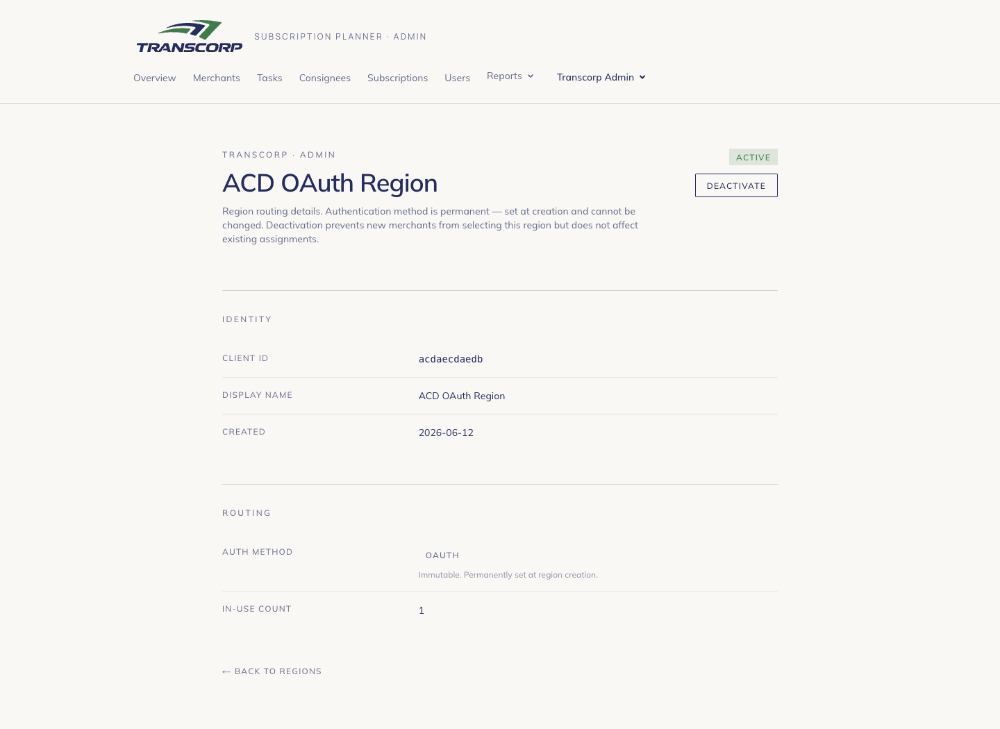
- **"AUTH METHOD" value indented** — same recurring bug as the merchant detail. (Gap D)
- Wide ~900px (≠ narrow details). (Gap E)

#### A22 · New region — `/admin/regions/new`
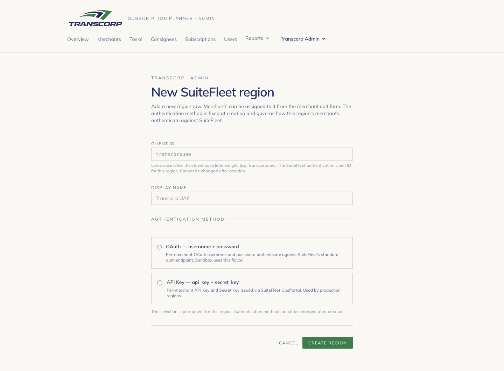
- **Radio-card pattern** — nicer than native selects, but used nowhere else. (Gap G)
- Primary **green** "CREATE REGION" (≠ navy in Users module). (Gap A)

#### Admin mobile (390px)
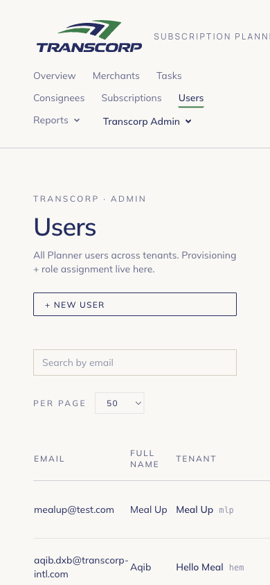
- **Tables overflow with no responsive layout**; top bar wordmark clips; nav wraps to 3 rows. (Gap C) — same on `admin-11-subscriptions-mobile.png` and `admin-19-inventory-mobile.png`.

---

### MERCHANT (logged in as `mpl-admin` / Meal Up)

#### M1 · Home "Welcome back" — `/`
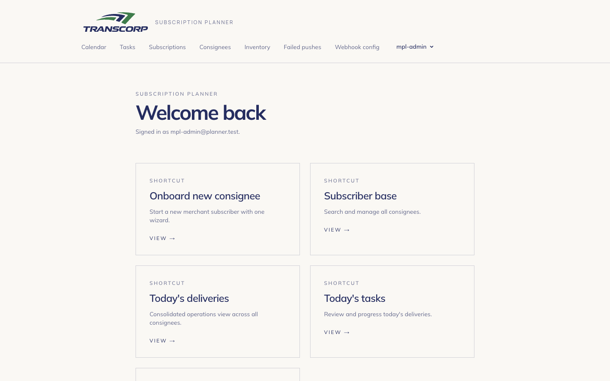
- **Terminology drift:** "consignee" vs "subscriber" vs "merchant subscriber" for one entity. (Gap J)
- Every card stamped a redundant "SHORTCUT" eyebrow.
- **No data** on the merchant home (just nav cards) while the admin Overview is data-rich — inconsistent dashboard philosophy.

#### M2 · Tasks — `/tasks`
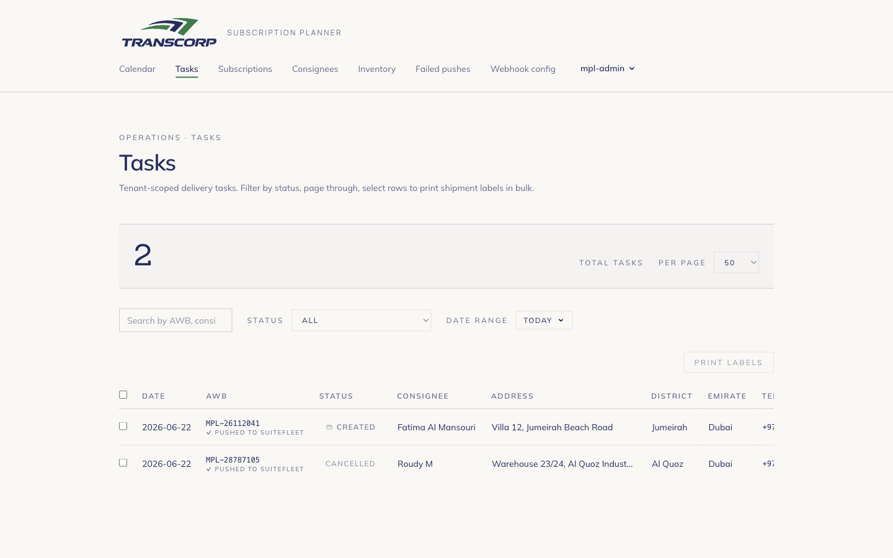
- **Table overflows the viewport at full desktop width** — TEL column clipped. (Gap C)
- "Per page" select **jammed inside the stat card**. (Gap F)
- Nav exposes **"Failed pushes" / "Webhook config"** — dev vocabulary to operators. (Gap J)
- CREATED icon vs CANCELLED bare text. (Gap B)

#### M3 · Calendar "All deliveries" — `/calendar`
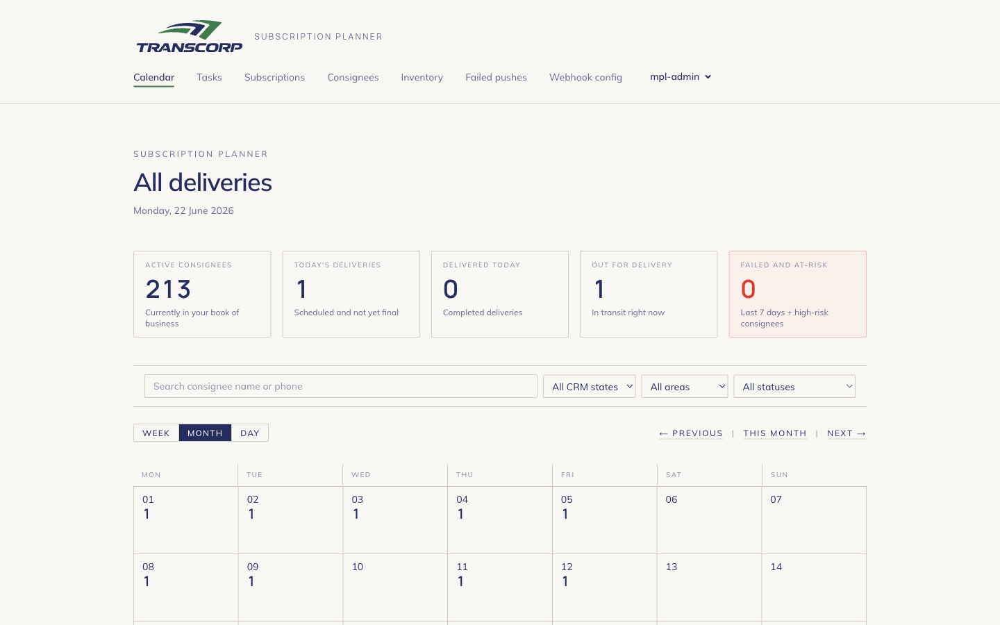
- ✅ **Best surface:** 5-card stat grid matching the admin Overview, clean WEEK/MONTH/DAY segmented control.
- Day cells show a bare "1" with no unit; three native selects.

#### M4 · Consignees — `/consignees`
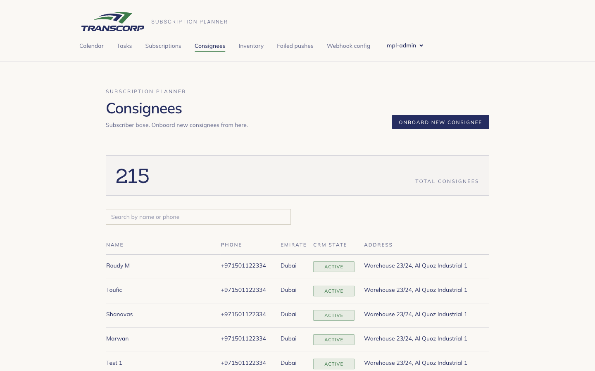
- **In-tenant test/seed data** visible to a real operator: a consignee named "Test 1", many rows sharing one phone + address. (§3)
- Primary is **navy-filled** "ONBOARD NEW CONSIGNEE" (≠ admin outline "+ NEW…"; ≠ green merchant form saves). (Gap A)
- "Subscriber base" terminology again. (Gap J)

#### M5 · Consignee detail (tabbed) — `/consignees/[id]`
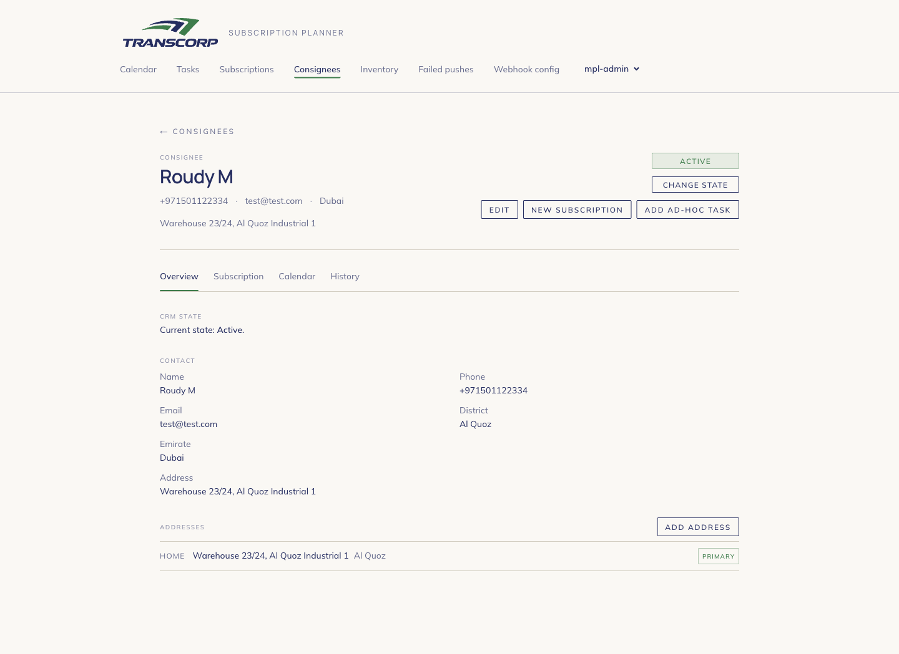
- **Completely different detail system from admin:** tabs (Overview/Subscription/Calendar/History) + 2-column grid + **sentence-case** labels. (Gap D)
- Many outline buttons of varying widths. Realises the brief's "consignee detail with calendar" (the only tabs in the app).

#### M6 · Consignee edit — `/consignees/[id]/edit`
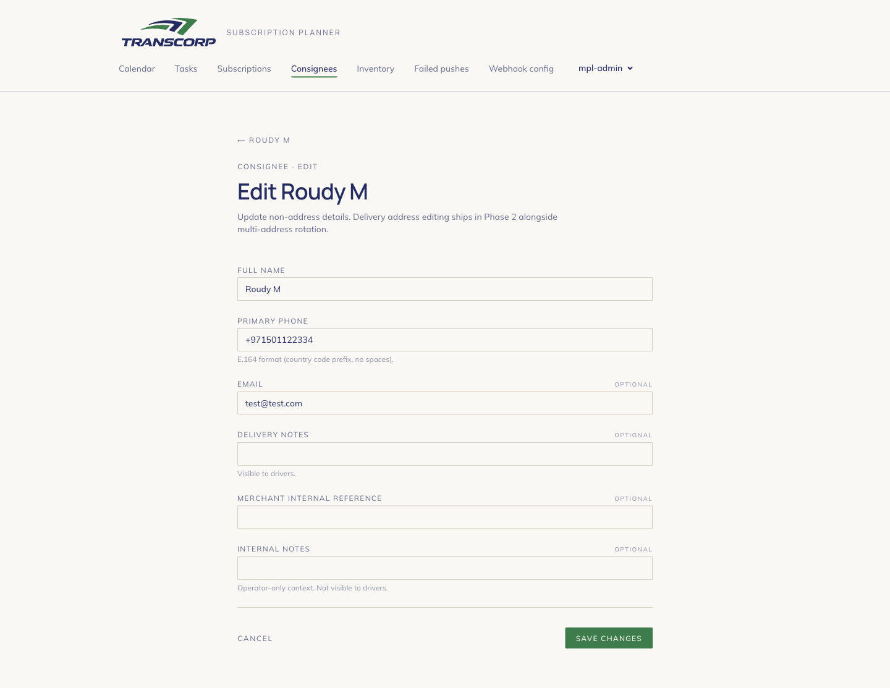
- **Labels UPPERCASE here but sentence-case on the detail** — inconsistent within one entity. (Gap D/I)
- SAVE CHANGES **green** (≠ navy list button). (Gap A)
- ✅ Good: right-aligned "OPTIONAL" tags + helpful "Visible to drivers" helper text.

#### M7 · New consignee — `/consignees/new`
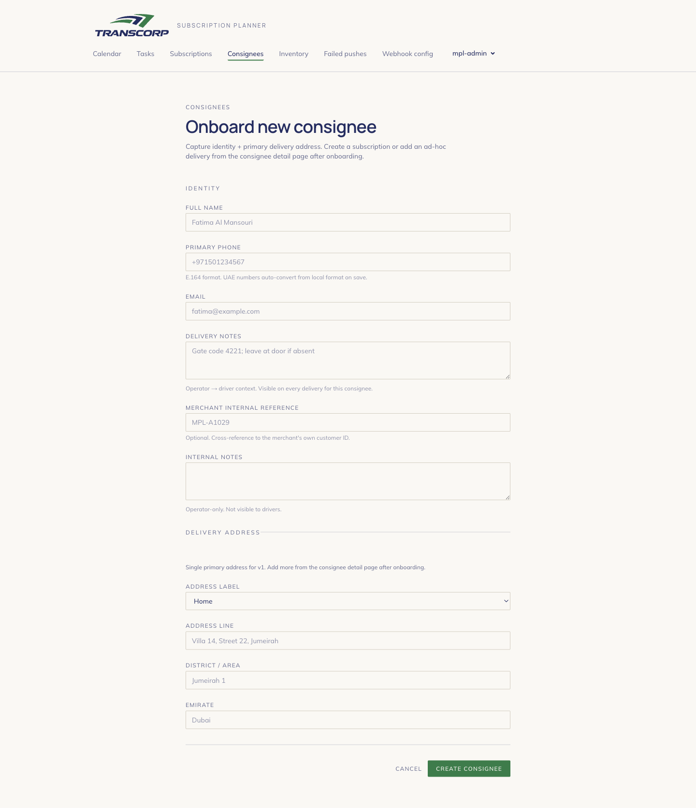
- The brief's "onboarding wizard" is actually a single long form (not stepped). Green primary; narrow column.

#### M8 · Subscriptions — `/subscriptions`
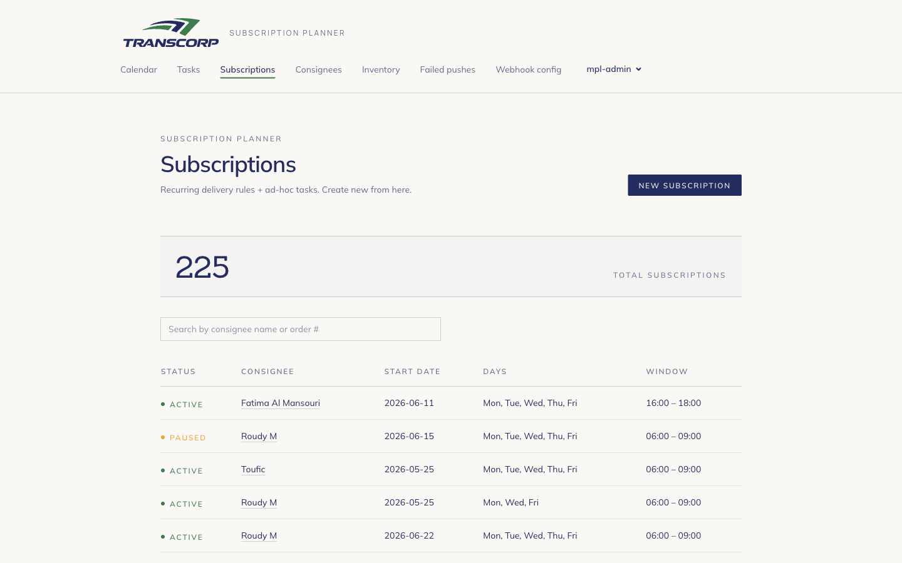
- ✅ **Consignee column shows the NAME as a link** — proving the admin hash (A11) is a straight bug.
- "225 total" — in-tenant seed inflation. (§3)
- "NEW SUBSCRIPTION" navy (≠ green form saves). (Gap A)

#### M9 · Subscription detail — `/subscriptions/[id]`
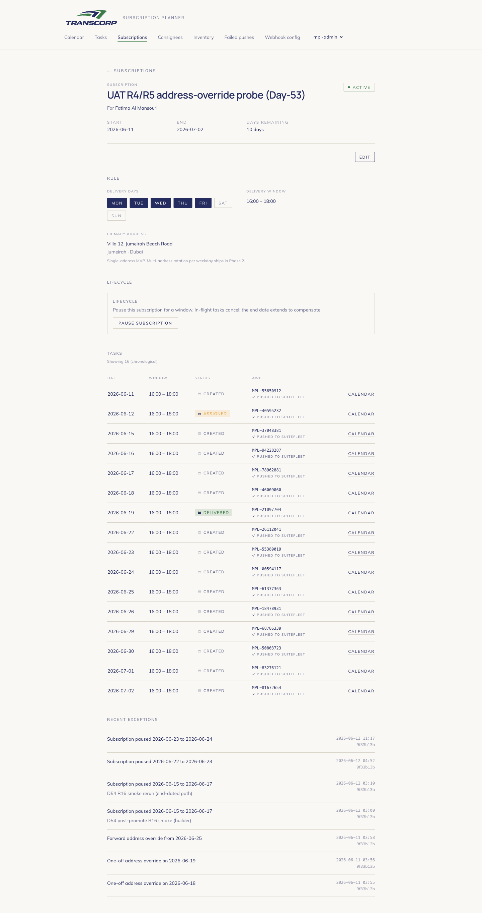
- Rich/dense (vs admin's sparse FieldRows): **day-chips** for delivery days (admin shows text), full materialised tasks table, exceptions log.
- **Test-artifact name in prod:** "UAT R4/R5 address-override probe (Day-53)".
- Tasks table mixes CREATED/ASSIGNED/DELIVERED in **three badge styles**; exceptions show raw mono hashes + full timestamps. (Gap B/J)

#### M10 · Subscription edit — `/subscriptions/[id]/edit`
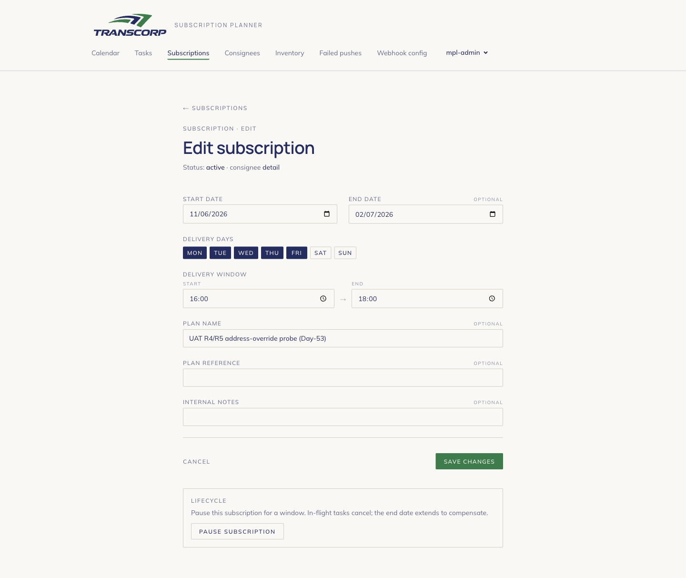
- ✅ Day-chip toggle (good) — but a one-off. Native date/time inputs. (Gap G)
- **Save/Cancel sit mid-page**, then a "Pause subscription" card renders *below* the actions — awkward action placement.

#### M11 · New subscription — `/subscriptions/new`
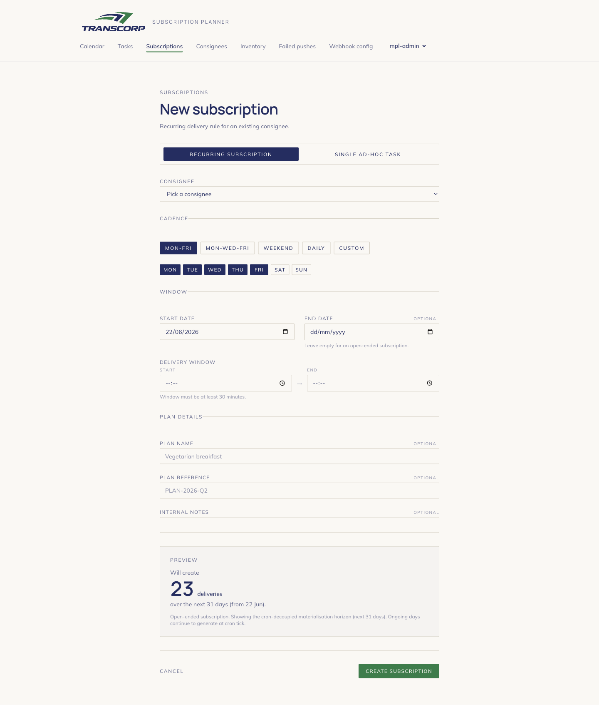
- ✅ **Best-designed form:** mode segmented control, **cadence presets** ("MON-FRI"/"WEEKEND"/"DAILY"), live **"Will create 23 deliveries" preview**.
- The presets prove cadence-condensing exists — yet the admin list (A11) still shows verbose text. These good patterns are one-offs. (Gap G)

#### M12 · Inventory report — `/reports/inventory` *(your "1 date/2 date")*
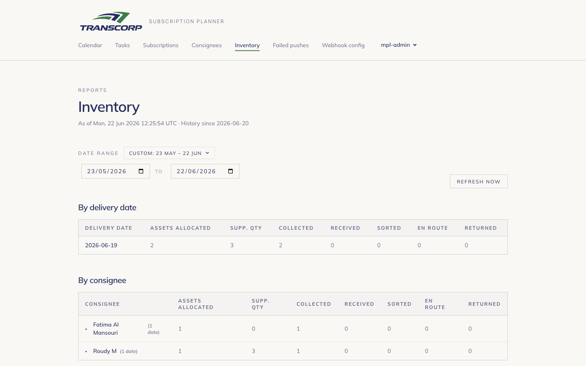
- **"(1 date)" labels misaligned** beside names that wrap to 2 lines. (Flag #5)
- Headers wrap. **Third near-identical** inventory/asset table.

#### M13 · Failed pushes — `/admin/failed-pushes`
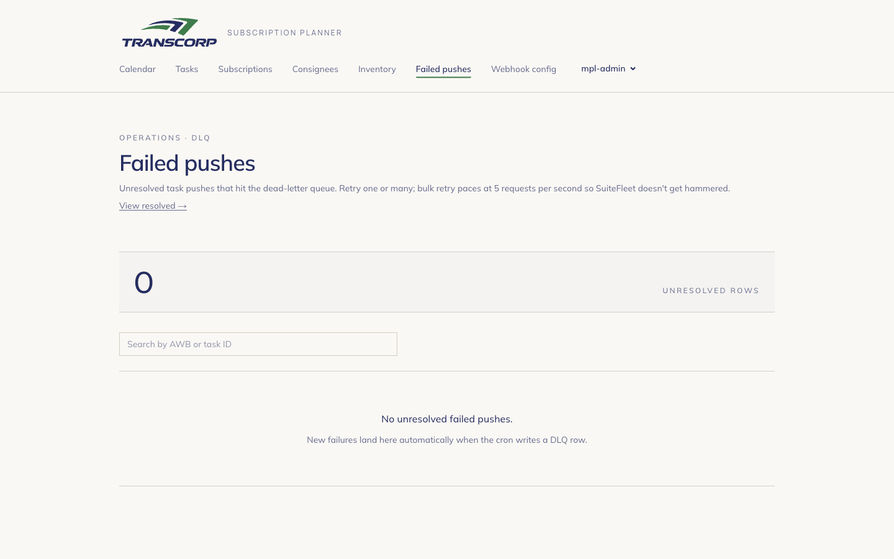
- **Engineer jargon to an operator:** "OPERATIONS · DLQ", "dead-letter queue", "5 requests per second so SuiteFleet doesn't get hammered", "cron writes a DLQ row". (Gap J)
- A *fourth* empty-state style (plain centred text). (Gap H)

#### M14 · Resolved pushes — `/admin/failed-pushes/resolved`
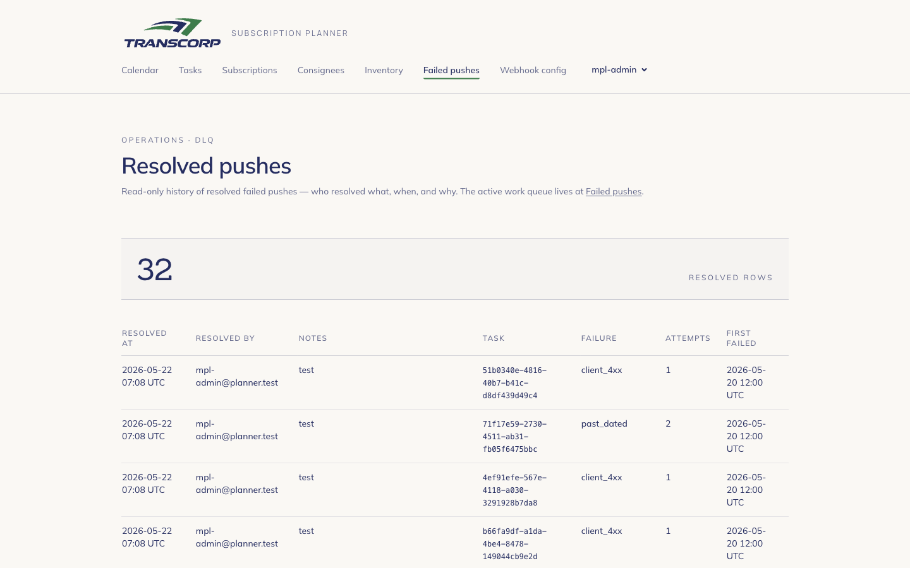
- **Raw DB dump:** full UUIDs wrapping to **3 lines** per row, timestamps wrapping to 3 lines with "UTC", raw enum codes ("client_4xx", "past_dated"). (Gap C/J)
- Headers wrap.

#### M15 · Webhook config — `/admin/webhook-config`
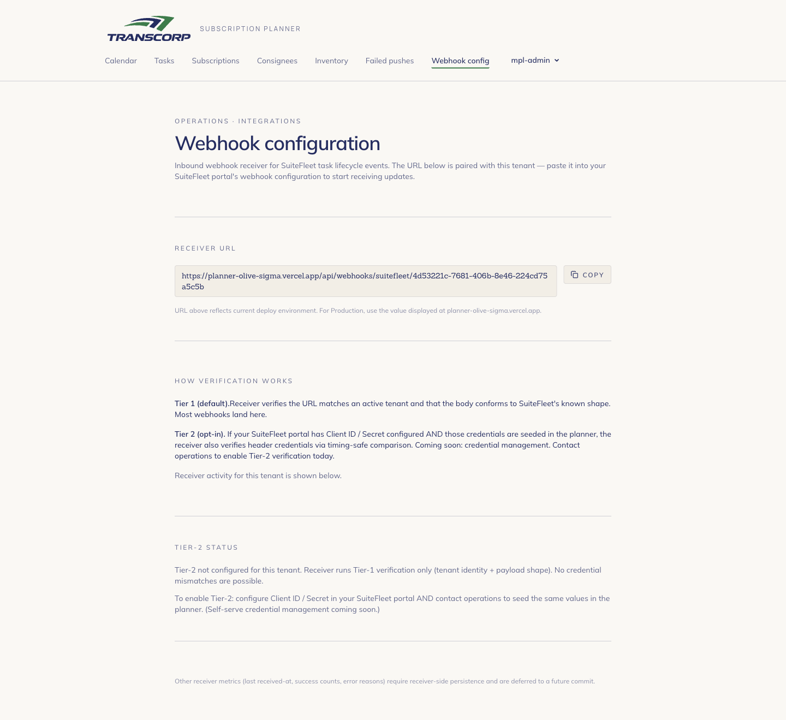
- Pure technical documentation to an operator; **"deferred to a future commit"** and "Coming soon: credential management" sitting in the live UI. (Gap J)
- Receiver URL wraps inside its box; long prose, weak hierarchy.

#### Merchant mobile (390px)
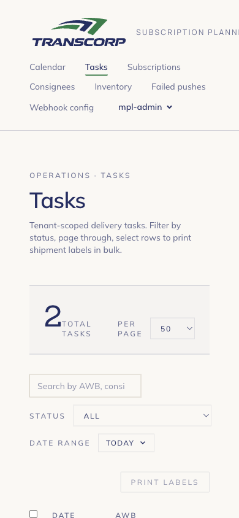
- Same non-responsive tables; stat card crams number + label + "Per page" + select; top bar clips; nav wraps to 4 rows. (`merchant-04-consignees-mobile.png` confirms.)

---

## 7. Method, coverage & integrity

- **Access:** read-only walk of the live product on your already-logged-in browser session (admin = `transcorp-admin@planner.test`; merchant = `mpl-admin` / Meal Up). No service-role, no impersonation, no DB writes, no mutating clicks (nothing Saved/Refreshed/Disabled/Reset). Detail-page IDs were obtained by navigating the UI.
- **Coverage:** 22 admin + 15 merchant desktop surfaces, every list/detail/edit/new page in both areas, plus 5 mobile captures. **Nothing was unreachable.**
- **Screenshots:** all 43 live in `audit/screenshots/`. Raw per-surface notes in `audit/notes.md`.
- **Scope honoured:** no code changed, no product PR opened. This is the scoping artifact only.

**Recommended next step (Step 2, on your go):** a design-system proposal — the shared component kit (§4 Gaps A–J) with concrete tokens, plus a prioritised remediation order (the test-data fence in §3 is the highest-impact, lowest-risk first move).
